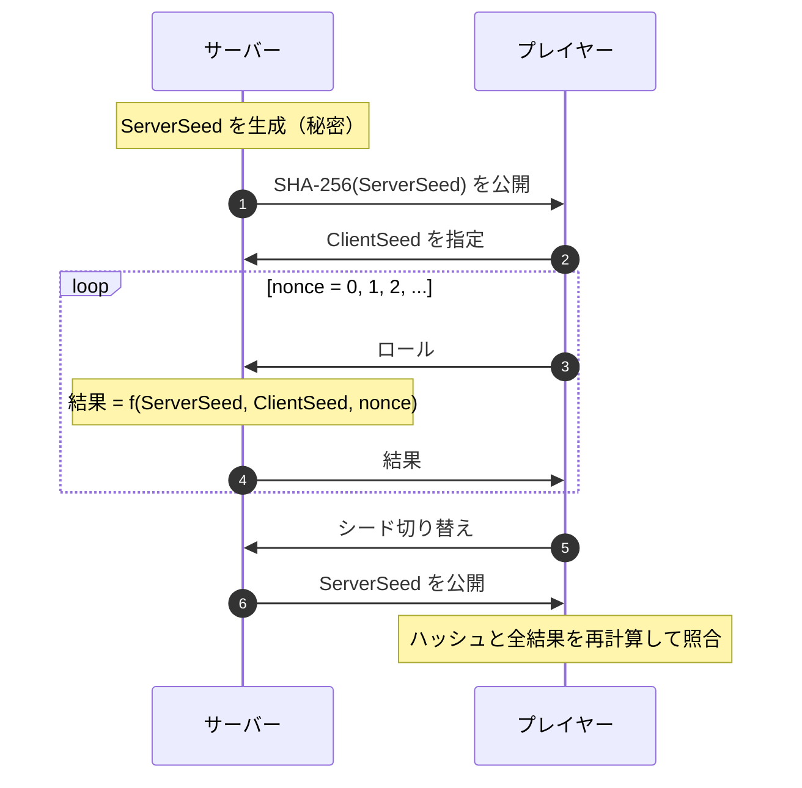
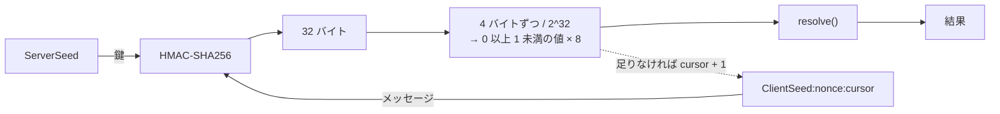
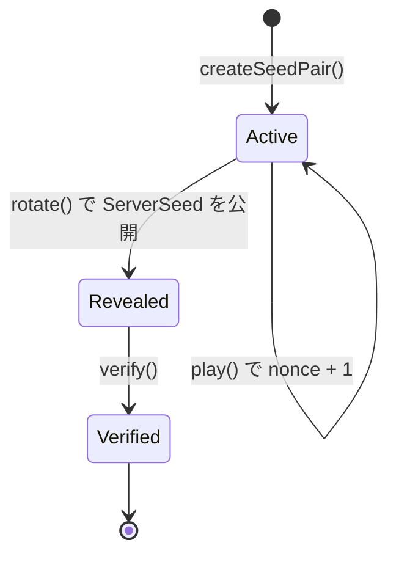
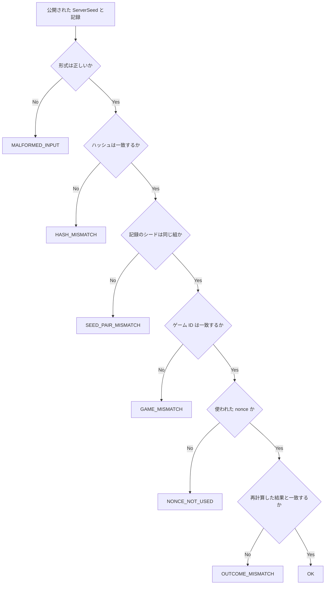

# Provably Fair Algorithm

Provably Fair の TypeScript 実装と、それを使ったダイスゲームのデモ。

サーバー側で決めた乱数が後から操作されていないことを、プレイヤーが自分で計算して確かめられる。乱数は HMAC-SHA256 で作っていて、計算式は既存の検証ツールと同じ。

## 仕組み

サーバーは最初にシード（ServerSeed）を作り、そのハッシュだけを先に見せる。プレイヤーは自分のシード（ClientSeed）を決めてプレイする。シードを切り替えるときに ServerSeed を公開するので、プレイヤーはハッシュが合っているか、各回の結果が計算どおりかを確認できる。



ServerSeed はハッシュで先に固定されているので、サーバーが途中で差し替えればハッシュが合わなくなる。ClientSeed はプレイヤーが決めるので、サーバーは結果を狙って作れない。nonce は 1 回ごとに増える通し番号で、同じシードの組み合わせでも毎回違う乱数になる。

### 乱数の作り方



HMAC の出力 32 バイトを 4 バイトずつ区切り、32 ビット整数として読んで 2³² で割る。1 回の HMAC で 8 個取れて、それ以上要るゲームは cursor を増やして続きを計算する。

ダイスは 1 個だけ使って `floor(x * 10001) / 100` を出目にしている（0.00〜100.00）。

### シードの状態



`rotate()` は今の組を公開すると同時に、新しい組を nonce 0 から始める。

サーバー内部で持つ `SecretSeedPair` と、プレイヤーに返す `PublicSeedPair` は別の型にしてある。`PublicSeedPair` には `serverSeed` を入れられないので、秘密をそのまま返すコードはコンパイルが通らない。

### 検証



記録はサーバーから来たデータなので、型が付いていても `verify()` の中で形式から検査し直している。

### 出目の分布

固定シードで 1,000 万回振った結果。縦軸は 995,000 から。線は期待値の 1,000,000。


| 項目 | 結果 | 目安 |
|---|---|---|
| カイ二乗値（10 区間） | 4.92 | 自由度 9。5% 棄却点 16.92 |
| カイ二乗値（100 区間） | 110.4 | 自由度 99。5% 棄却点 123.23 |
| target 50 の勝率 | 0.499983 | 理論値 0.49995、標準誤差 0.000158 |
| 隣り合う出目の相関 | -0.000286 | 0 が理想。標準誤差 0.000316 |

1 回の結果だけだと偶然もありうるので、別々のシード 1,000 組で各 1 万回振って同じ検定を繰り返した。

| 項目 | 結果 | 一様なら |
|---|---|---|
| カイ二乗値の平均 | 9.065 | 9 |
| 5% 水準で棄却された割合 | 5.5% | 約 5%（1,000 組なので ±1.4% 程度はぶれる） |
| 1% 水準で棄却された割合 | 0.9% | 約 1% |

どれも一様な乱数で期待される範囲に入っている。`npm run distribution` で同じ数字が出る（1 分ほどかかる）。

## 型

検証済みの値はブランド型にしていて、パーサを通さないと作れない。

| 型 | 中身 |
|---|---|
| `ServerSeed` / `ServerSeedHash` | 小文字 16 進 64 桁 |
| `ClientSeed` | 1〜64 文字の ASCII。空白と `:` は不可 |
| `NonNegativeInt` | 0〜`Number.MAX_SAFE_INTEGER` の整数。`Nonce` `Cursor` `PositiveInt` はこれの部分型 |
| `UnitFloat` | 0 以上 1 未満 |
| `FixedArray<T, N>` | 長さ N の readonly タプル |

数値リテラルはコンパイル時にも見ている。`engine.nonceOf(-1)` や `generateFloats(input, 1.5)`、`floatCount: 0` のゲームは型エラーになる。型で拾えないもの（上限超えや `as` での迂回）は実行時に弾く。型のテストは `test/types.test-d.ts`。

## 使い方

Node.js 22 以上。

```bash
npm install
```

デモを起動して http://localhost:3000 を開く。ポートは `PORT` で変えられる。

```bash
npm start
```

何回かロールしてから「切り替え」を押すと ServerSeed が公開され、ブラウザ側（WebCrypto）で全結果を再計算して ✓ / ✗ を出す。

テスト:

```bash
npm test
```

### ライブラリとして

```ts
import { dice, engine } from './src/index.js';

const seed = engine.generateServerSeed();
const client = engine.parseClientSeed('my-seed');
if (!client.ok) throw new Error(client.error.kind);

let pair = engine.createSeedPair(seed, client.value);
const publicPair = engine.toPublic(pair); // プレイヤーに返すのはこっち

const { pair: next, record } = engine.play(pair, dice, { target: 50 });
pair = next;

const { revealed } = engine.rotate(pair, engine.generateServerSeed(), client.value);
const result = engine.verify(revealed, record, dice);
// 失敗時は result.error.kind に理由が入る
```

ゲームは `GameDefinition` で定義する。`floatCount` と `resolve` の引数の長さが合わないと型エラーになる。

```ts
import type { GameDefinition, UnitFloat } from './src/index.js';

const coinFlip = {
  id: 'coin',
  floatCount: 1,
  parseParams: () => ({ ok: true, value: null }),
  resolve: ([x]: readonly [UnitFloat]) => (x < 0.5 ? 'heads' : 'tails'),
} as const satisfies GameDefinition<'coin', null, 'heads' | 'tails', 1>;
```

### デモの API

| | |
|---|---|
| `GET /api/state` | 今のシード（公開分）と履歴 |
| `POST /api/bet` | `{"target": 2〜98}` でロール |
| `POST /api/rotate` | `{"clientSeed": "..."}` で切り替え。前の ServerSeed と履歴が返る |

ボディは 1KB まで。

## 構成

```
src/
  types.ts        型とエンジンのインターフェース
  engine.ts       実装（node:crypto）
  games/dice.ts   ダイス
  server.ts       デモサーバー（依存なし）
web/index.html    デモの画面とブラウザ側の検証
test/             テスト（期待値は Python で別に計算）と型テスト
scripts/          分布の集計
```

## 注意

- デモサーバーは状態をメモリに 1 人分しか持たない。タブ間で共有され、再起動で消える。認証もないので公開環境向けではない。
- ブラウザ側の検証はサーバーと別に書いてある。式を変えるときは `src/` と `web/index.html` の両方を直すこと。
- 既存の検証ツールの公開例とはまだ突き合わせていない。
- `rotate()` が弾くのは直前と同じ ServerSeed だけ。新しいシードは `generateServerSeed()` で作る前提。
